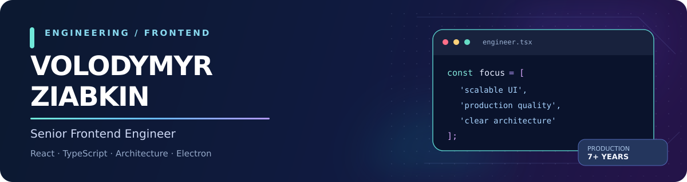

  

   

  
  
  

## About me

I’m a **Senior Frontend Engineer with 7+ years of commercial experience** building and modernizing production applications in **betting operations, player support, and food delivery**.

My focus is on **frontend architecture, React and TypeScript, reliable user interfaces, and solving real production problems**. I enjoy turning complex workflows into maintainable products and working across frontend and backend boundaries when needed.

### Engineering highlights

- **Modernization:** Delivered a phased **React 16 → 19** migration, including routing, state management, class-to-function refactoring, and dependency upgrades.
- **Production debugging:** Resolved a recurring issue in a **WebSocket-driven virtualized list** by tracing unstable callback references.
- **Architecture and components:** Worked with **Feature-Sliced Design**, shared UI components, and **Storybook** in production environments.
- **End-to-end product work:** Owned frontend delivery and releases; previously built **React + Node.js** administration tools and REST/API integrations.

## Tech stack

**Frontend & UI**

**Architecture, data & state**

**Backend & integrations**

Also contributed to **NestJS** services and worked with authentication, webhooks, Stripe, and API documentation.

**Testing & AI-assisted workflow**

I use AI tools to speed up implementation and test generation, with an emphasis on **architecture, code review, and verification**.

## Featured projects

Portfolio projects are in progress. This section will feature selected React/TypeScript and full-stack work with **working demos, architecture notes, and tests**.

---

  <strong>Open to remote frontend and frontend-focused full-stack opportunities.</strong>
    
  <a href="mailto:volodymyr.ziabkin@gmail.com">Get in touch</a>

